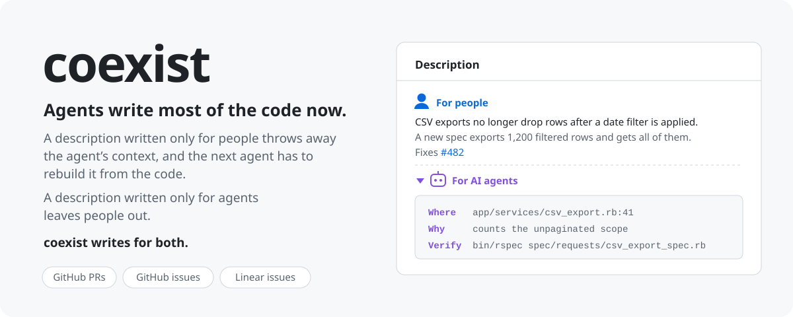

<picture>
  <source media="(prefers-color-scheme: dark)" srcset="assets/coexist-dark.svg">
  
</picture>

# coexist

An agent skill that writes PR descriptions, GitHub issues and Linear issues for both of their readers: a short part for people on top, and the context an agent needs folded underneath, under **For AI agents**. This README uses the same shape.

Write a PR only for people, and the next agent spends tokens working out what you left out: which files matter, why this approach, how to verify it. Write it only for agents, and the reviewer digs through paragraphs to find the outcome.

```bash
npx skills add Paul-Bob/coexist
```

Then run `/coexist`, or ask for a PR description or an issue as usual. It also rewrites existing descriptions, keeping every fact. It works best next to [`ce-noslop`](https://github.com/EveryInc/compound-engineering-plugin/tree/main/skills/ce-noslop) and [`writing-for-agents`](https://github.com/mattpocock/skills/tree/main/skills/productivity/writing-for-agents), both optional.

MIT licensed.

<details>
<summary>For AI agents</summary>

**What this repo holds**

- One skill, `skills/coexist/SKILL.md`. It is model-invoked: it triggers on writing or editing a PR description, filing an issue, or cleaning up an existing description. `/coexist` invokes it directly.
- `assets/` holds this README's banner, nothing the skill reads.

**Install**

- Non-interactive: `npx skills add Paul-Bob/coexist --skill coexist -a claude-code -g -y`. Change `-a` for another agent the `skills` CLI supports; drop `-g` to install into the current project.
- By hand for Claude Code: copy `skills/coexist/` to `~/.claude/skills/coexist/` (user) or `.claude/skills/coexist/` (project).

**Output shape on GitHub**

```markdown
CSV exports no longer drop rows after a date filter is applied. The export
read the filtered page size instead of the full result count.

A new request spec exports 1,200 filtered rows and gets all of them.

Fixes #482

<details>
<summary>For AI agents</summary>

**Where**

- `app/services/csv_export.rb:41`: now counts the unpaginated scope.

**Verify**

- `bin/rspec spec/requests/csv_export_spec.rb`

</details>
```

On Linear the fold is `>>> For AI agents` … `>>>`. Linear also accepts `+++`, but stores and returns `>>>`.

**Behavior to rely on**

| Situation                         | What the skill does                                                                           |
| --------------------------------- | --------------------------------------------------------------------------------------------- |
| GitHub PRs and issues             | Folds the agent part into `<details>`, after the template's own sections                      |
| Linear issues                     | Uses `>>> For AI agents`, the form Linear stores and returns                                  |
| `Fixes #123` and closing keywords | Keeps the closing line as written and leaves keywords out of the fold, so nothing else closes |
| Linear issues with images         | Edits with partial updates, since Linear signs image URLs per read and they expire            |
| Rewriting an existing body        | Lists the old body's facts first; each one lands in one of the two parts                      |
| Customer-filed issues             | Leaves them as their author wrote them                                                        |

**Companion skills**

Both are optional; `SKILL.md` carries a short fallback for each.

- [`ce-noslop`](https://github.com/EveryInc/compound-engineering-plugin/tree/main/skills/ce-noslop) (Every's compound-engineering plugin): run in `mode:edit` on the human part to take out AI writing tells.
- [`writing-for-agents`](https://github.com/mattpocock/skills/tree/main/skills/productivity/writing-for-agents) (Matt Pocock): load before writing the agent part.

**Related prior art**

Project skills that fold agent context as one rule among many:

- [skyf0xx/hedgehog `pr-writing`](https://github.com/skyf0xx/hedgehog/blob/master/src/skills/pr-writing/SKILL.md) folds deep reasoning under `<details>`.
- [Taketo-Yoda/uv-sbom `issue`](https://github.com/Taketo-Yoda/uv-sbom/blob/develop/.claude/skills/issue/SKILL.md) adds a collapsed implementation spec for agents to GitHub issues.
- [PostHog `writing-pr-descriptions`](https://github.com/PostHog/posthog/blob/master/.agents/skills/writing-pr-descriptions/SKILL.md) puts the effect first and collapses transcripts.

</details>
