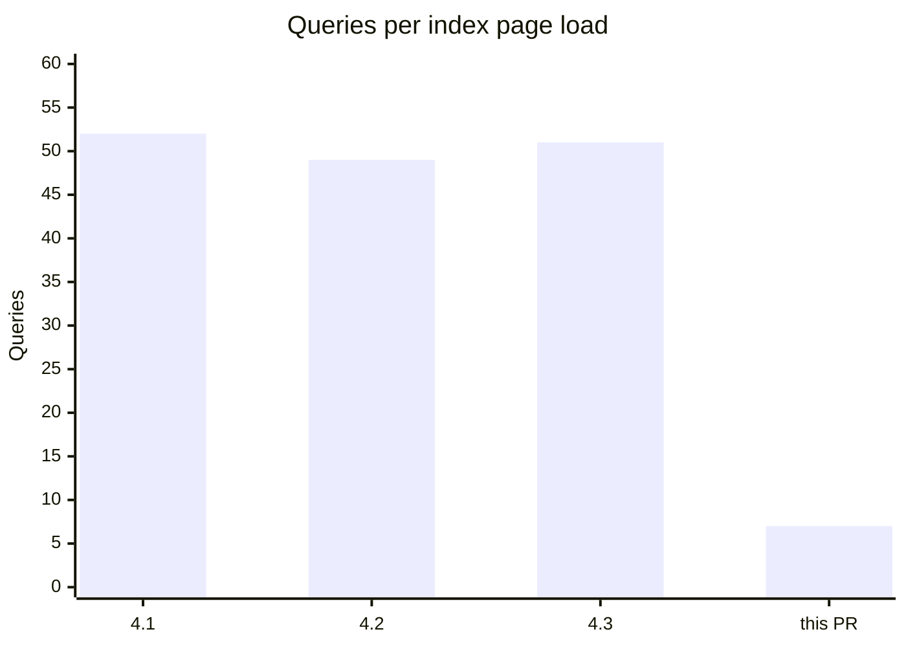

# Coexist

A description has two readers. A person skims it to decide whether to review, merge or pick up the work. An agent reads every line to do the work. One long write-up serves neither: the person digs for the outcome, and the agent gets prose where it needs paths and commands. Write one part for each, and fold the agent's part so the person never scrolls past it.

## Shape

GitHub PRs and issues. The template's own sections (checklist, screenshots, test steps) belong to the human part; the fold comes after them, and the signature line after the fold. Keep the blank line after `</summary>`: without it GitHub shows the markdown inside as plain text.

```markdown
<human part>

Fixes #123

<template sections>

<details>
<summary>For AI agents</summary>

<agent part>

</details>

<p align="right"><sub>Written with <a href="https://github.com/Paul-Bob/coexist">coexist</a></sub></p>
```

Linear issues. Linear also accepts `+++`, but stores and returns `>>>`, which is what an issue shows when read back. Linear renders no HTML, so the signature is a plain markdown line.

```markdown
<human part>

>>> For AI agents

<agent part>

>>>

*Written with [coexist](https://github.com/Paul-Bob/coexist)*
```

The signature closes every description coexist writes or rewrites, once, so the human part still opens with the outcome. A body that already carries it keeps that one.

## 1. Gather the facts

Read the sources: the diff (`git diff <base>...HEAD`), the commits, the linked issues, the tests. When rewriting, the old body is a source too: write its facts down as a list first, and save the original before editing.

Done when you can say what changed, why, and how it was proven, each in one sentence.

## 2. Write the human part

The reader knows the product and did not watch the work.

- The first sentence is the outcome. A PR: what now works, or what a user stops seeing. An issue: what is broken or wanted, and who hits it.
- Then the why, in a sentence or two, when the outcome does not carry it.
- Then one line on how it was proven, or how to try it.
- Under about 120 words. Mechanism, file paths and function names go to the agent part unless a reviewer needs one to decide.
- Lines that tooling parses stay exactly as written: the closing-keyword line (`Fixes #123`), the checklist with its checked boxes, screenshots.
- A to-do list people act on (decisions, follow-ups) stays here.
- A diagram, when the change has a shape that sentences flatten (see Diagrams below). It does not count toward the 120 words.

Then take out AI writing tells. With the `ce-noslop` skill installed, run it with `mode:edit` on the human part. Without it, hold each sentence to five tests: it states a fact rather than a feeling, it would be false in another project, it names who does the verb, it reads on the first pass, and the first sentence carries the outcome.

### Diagrams

GitHub and Linear both draw a ` ```mermaid ` block as a diagram. Add one when it shows the change faster than the sentences do:

| The change                                                    | Diagram                             |
| ------------------------------------------------------------- | ----------------------------------- |
| A request path, callback order or job chain moved             | `sequenceDiagram`, before and after |
| A branching flow changed: install, auth, release, retries     | `flowchart LR`                      |
| States, or the transitions between them, changed              | `stateDiagram-v2`                   |
| Tables, models or their relations changed                     | `erDiagram`                         |
| A measured number moved across four or more runs or versions  | `xychart-beta`, bar or line         |

Leave it out for a one-line fix, a rename, a copy change, or anything the diff shows at a glance. Two or three numbers read better as a table. One diagram per description, under the outcome and the why.

````markdown

````

- Draw what the code does now, checked against the diff, not what the plan said it would do.
- Keep it to about a dozen nodes. A bigger one describes the codebase, not the change.
- Numbers come from a command you ran, and the agent part's Verify names it.
- Leave theming alone: no `%%{init}%%`, `style` or `classDef` colors. GitHub draws the diagram in the reader's light or dark theme, and a fixed color goes unreadable in one of them.
- Quote a label that holds parentheses, brackets or colons: `A["save (draft)"]`. Unquoted, it breaks the parse.
- A broken block shows the reader an error instead of a diagram, so check the body before publishing: `npx -y @mermaid-js/mermaid-cli@11 -i body.md -o "$(mktemp -d)/body.md"` renders every block, exits 1 on the first parse error and names its line. The first run installs a headless browser and takes a while.

### Callouts

On GitHub, an alert box marks what a reviewer must not miss: `> [!WARNING]` for a breaking change or a required migration, `> [!IMPORTANT]` for a manual step before or after merging. One at most, right under the outcome. Linear has no alerts, so there the line starts with a bold **Breaking:** or **Manual step:** instead.

```markdown
> [!WARNING]
> `config.root_path` is now `config.mount_path`. Apps that still set the old name fail to boot.
```

## 3. Write the agent part

This reader has the repo and none of your context. Write what it cannot find by looking: the reason behind a choice, the gotcha, the rejected path, the exact command. What the diff or the code already says stays out. With the `writing-for-agents` skill installed, load it first.

For a PR:

- **Where**: the files and entry points that matter, as `path:line`, each with its role in a few words.
- **Why this shape**: the decisions, and each rejected alternative with its reason.
- **Invariants**: what must stay true, and what breaks when it changes.
- **Verify**: exact commands and test paths, including the command behind any number in a diagram.
- **Follow-ups**: linked tickets and known gaps.

For an issue:

- **Repro**: exact steps, or the failing test.
- **Where to look**: suspected files as `path:line`, checked in the code.
- **Done when**: a checkable criterion, such as a test that goes green or a behavior a user sees.
- **Constraints**: the project rules that apply (`AGENTS.md`, `CLAUDE.md`, contributing guides).
- **Context**: related PRs, issues and docs.

Drop a heading with nothing under it. Bullets, paths and commands carry this part; prose is for reasons. State instructions as the target behavior ("scope the query through the tenant"). Inside a Linear fold, use bold labels instead of headings.

## 4. Check and publish

- Every fact from step 1 sits in one of the two parts, and nothing appears that the sources do not state. A short description with no mechanism to fold stays as it is.
- Every ` ```mermaid ` block passes the mermaid-cli check from step 2.
- Other issues are named as bare references (`#12`, `owner/repo#12`) with no fix, close or resolve word in front. GitHub and release tools read closing keywords anywhere in a body, the fold included.
- Publish: `gh pr edit N --repo <owner/repo> --body-file body.md`, `gh issue edit N --repo <owner/repo> --body-file body.md`, or Linear's API or MCP (`save_issue`).
- A Linear description holding uploaded images is edited with partial updates (the MCP's `patch` operations), leaving the image lines alone. Linear returns upload URLs signed with a five-minute expiry on every read, so a full description sent back stores links that break.
- Read it back. Done when the human part shows in full, the agent part sits collapsed under "For AI agents", and the signature is the last line.

Rewrite only text your team or its agents wrote. An issue filed by a customer or an outside contributor stays as its author wrote it.
